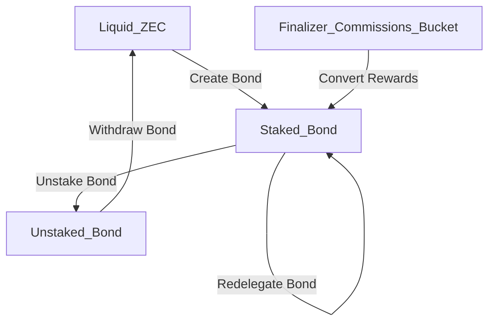

# Bond Actions and States

**FIXMEs:**

- Does finality need to appear on this state diagram?
- xxx

## Consensus Rule Restrictions

Here we list consensus rule restrictions for transactions containing the following actions _in addition_ to rules which apply to all transactions.

Here we assume a set of "cryptography widget guarantees" are already verified and don't specify them. (XXX: Specify these somewhere!)

Assumption: "contextual" txn verification has access to a subset of "most recently finalized state" (at least it's PoW height), as well as a subset of "most recent unfinalized state".

### `Create Bond` action 

- No txn inputs can be present except those from a "set of acceptable shielded pools" (XXX: Define "acceptable shielded pools" as a protocol constant)
- The block height must be a `staking day` block height
- The bond amount must be a power of 10 of ZATOSHI

### `Redelegate Bond` action 

- Must refer to an existing `Staked_Bond`

Nuance / Subtle: This does _not_ have a staking day blockheight restriction.

### `Unstake Bond` action 

- Must refer to an existing `Staked_Bond` which is at least one staking cycle old
- The block height must be a `staking day` block height

### `Withdraw Bond` action 

- Must refer to an existing `Unstaked_Bond` which is at least one staking cycle old
- The block height must be a `staking day` block height
- (provisional C) The "most recent finalized PoW Height" is > N staking cycles from the height of the `Unstake Bond` action.

#### Alternatives Considered to Provisional C:

- (provisional A) There are no restrictions based on finality.
- (provisional B) The "most recent finalized PoW Height" is > the height of the `Unstake Bond` action.  

### `Convert Rewards` action 

- Must refer to an existing `finalizer commissions bucket` which is at least one staking cycle old

Nuance / Subtle: This does _not_ have a staking day blockheight restriction.
